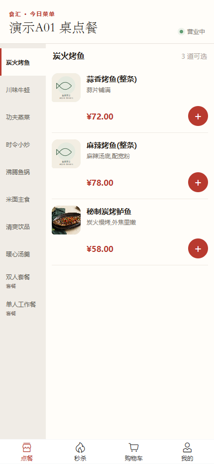
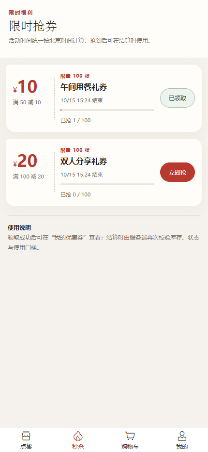
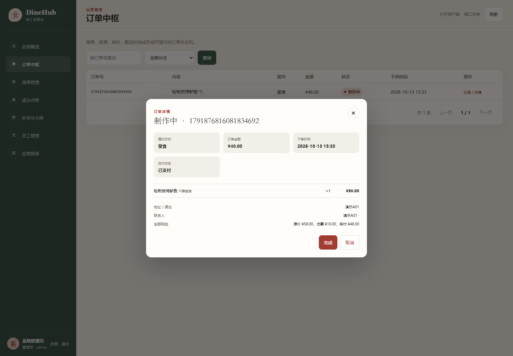

# DineHub · 食汇

[](https://github.com/wwjorker/dinehub/actions/workflows/ci.yml)

DineHub 是面向餐饮门店的点餐与经营管理项目，包含用户端 H5 和商家运营台，支持到店扫码点单与外送下单。项目围绕订单、优惠券和门店管理展开，重点是把异步发券、失败补偿、订单超时与可查询的业务状态连接起来。

## 主要功能

- **用户端**：浏览菜品和套餐、选择口味、购物车、堂食/外送、收货地址、优惠券结算、订单详情与再来一单。开发环境提供按设备隔离的演示登录和模拟支付。
- **商家端**：营业状态、订单处理、分类/菜品/套餐、图片上传、桌台二维码、优惠券活动、员工角色、经营统计与 Excel 报表。
- **优惠券**：限时领取、一人一券、异步发券结果查询、库存对账与故障处理。

后端为 Java / Spring Boot 模块化单体，使用 MyBatis、MySQL、Redis 和 RabbitMQ；页面使用 Vue 3 + Vant，由后端统一托管。

## 实际运行截图

以下截图采集于 2026-10-13 首轮独立演示环境（V15，堂食完成修复前），展示数据为测试数据，类别占位图明确标注“图片待补充”。这些截图不作为后续订单修复的运行验收证据。

### 用户端





### 商家运营台



## 一条完整使用流程

以外送为例：商家开启营业 → 用户进入菜单 → 选菜和口味 → 购物车选择外送与收货地址 → 确认优惠券与金额 → 提交订单 → 开发环境模拟支付 → 商家接单、开始配送、完成订单 → 用户查看最终订单状态。

堂食先绑定桌台，外送先选择地址。下单金额由服务端计算，重复提交通过请求标识控制；商家与用户看到的是同一笔订单的状态变化。上面是产品使用路径。首轮实际验证了领券与堂食下单至接单；发现的堂食完成状态冲突已在代码中修正，并通过针对性单元测试，最终页面与数据库复验仍待 Docker 恢复后完成。

## 关键设计

### 领券与异步发券

Redis Lua 在一次原子操作中校验活动、库存和领取资格，预扣名额并登记请求；RabbitMQ 将发券任务交给消费者写入 MySQL。接口先返回请求标识，用户端查询 `PENDING / SUCCESS / FAILED`，收到请求标识不代表优惠券已经到账。

### 失败补偿与恢复

发布确认与退回更新投递状态，未知结果由扫描任务按同一请求标识重试。消费者与补偿流程竞争数据库请求终态，避免同一请求同时落券和退还名额；重复消息和迟到消息按幂等规则处理。运营台提供库存对账与异常处理入口。

### 订单超时

未支付订单通过消息 TTL 和死信队列触发超时取消，数据库按当前状态做条件更新；低频扫描作为补充。支付与取消并发时，由状态条件决定哪一方能够完成迁移。

### 查询与基础保障

菜品查询支持 Redis 缓存和延迟双删；接口限流采用进程内令牌桶。用户订单与地址校验归属，员工使用 BCrypt 密码和角色权限。Flyway 管理数据库版本，日志带请求编号，开发环境提供健康检查和指标。

## 最短启动步骤

需要 Docker Engine 和 Docker Compose，在项目根目录执行：

```bash
docker compose up -d --build
```

- 用户端：[http://localhost:8080/h5/](http://localhost:8080/h5/)
- 商家端：[http://localhost:8080/h5/ops.html](http://localhost:8080/h5/ops.html)
- 开发管理员：`admin / 123456`，登录后先开启营业。

已有同名实例时不要直接启动第二份，先按[运行文档的隔离说明](docs/RUNNING.md#手机访问与环境隔离)准备独立环境。

[详细运行与演示](docs/RUNNING.md) · [开发与测试](CONTRIBUTING.md) · [压测脚本](scripts/jmeter/README.md) · [安全报告方式](SECURITY.md)

## 验证记录

本轮基线为 `2c80403`，日期为 **2026-10-13**，范围为展示文案、日志脱敏、演示图片迁移、README 整理，以及后续堂食完成修复和数据库注释迁移。具体执行结果与截图范围见[本轮验证记录](docs/VERIFICATION-20261013.md)。本轮不将历史全量测试、压测或真实支付结果计入通过项。

既有性能数字及原始口径保留在[历史压测记录](docs/BENCHMARK-HISTORY.md)，不作为当前版本重新测得的指标。

## 已知限制

- 演示登录和模拟支付仅面向开发环境；真实微信商户支付仍需配置证书、平台验签并单独验证，支付宝未接入。
- 限流为单实例进程内实现。Redis AOF `everysec` 在宿主机突然掉电时可能丢失最后约一秒的写入；Redis 数据卷丢失且请求尚未进入 RabbitMQ/MySQL 的组合故障不在当前恢复保证内。
- 部分演示菜品暂用明确的类别占位图。截图反映本轮隔离环境，不代表生产部署或全部功能验收。
- 堂食完成修复已通过 53 项相关后端测试，但尚未完成最终镜像、数据库迁移与真实页面复验；当前交付是待集成验收的审阅版本。
- 本轮没有扩大修复购物车地址刷新、列表分页及请求竞态等既有前端问题，正式部署前仍需针对具体使用场景验证。
