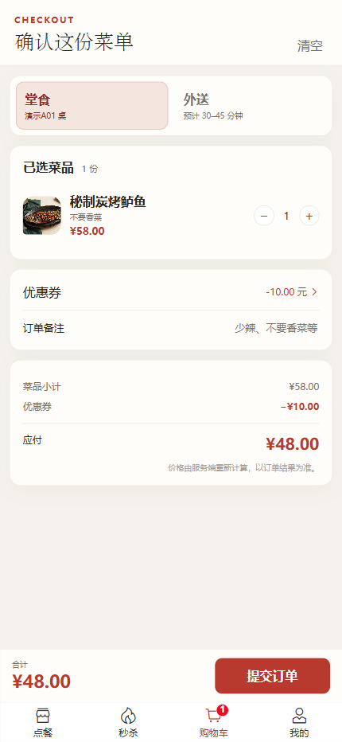
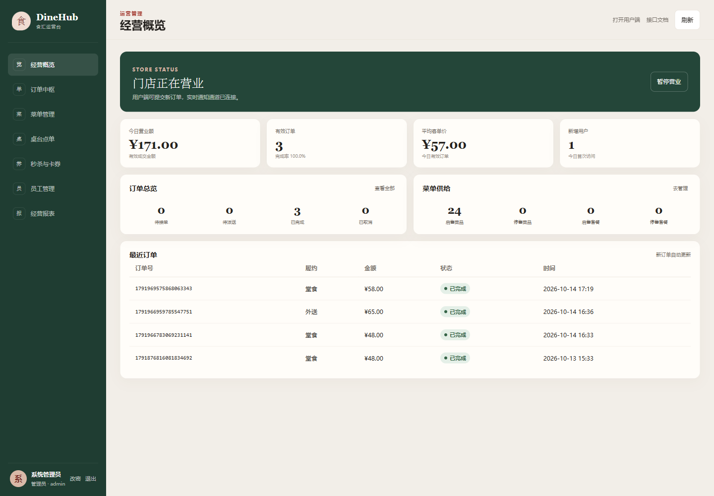
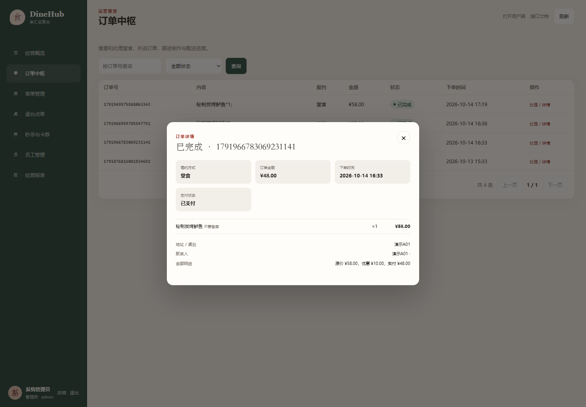
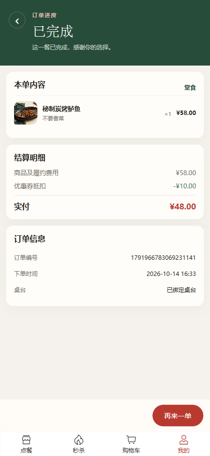

# DineHub · 食汇

DineHub 是面向餐饮门店的点餐与经营管理项目，包含用户端 H5 和商家运营台，支持到店扫码点餐与外送下单。用户可以选菜、领券、结算并查看订单进度；商家在同一套后台处理订单、维护菜单与查看经营数据。

项目围绕三个问题展开：

- **如何处理集中领券**：Redis Lua 校验库存与领取资格，RabbitMQ 异步发券，用户按请求标识查询最终结果。
- **如何处理发券中断**：记录投递与处理状态，通过重试、幂等消费和补偿处理重复消息、失败与未知结果。
- **如何让订单状态一致**：服务端计算结算金额，按当前状态执行支付、超时取消和履约操作，区分堂食与外送路径。

[页面展示](#页面展示) · [主要功能](#主要功能) · [关键设计](#关键设计) · [本地运行](#本地运行)

## 页面展示

以下为项目实际运行截图，使用演示数据，点击可查看原图。

**用户端 · 点餐、领券与结算**

<table>
  <tr><th>扫码点餐</th><th>限时领券</th><th>优惠券结算</th></tr>
  <tr>
    <td><a href="docs/screenshots/customer-menu.png"></a></td>
    <td><a href="docs/screenshots/customer-coupons.png"></a></td>
    <td><a href="docs/screenshots/customer-checkout.png"></a></td>
  </tr>
</table>

**商家端 · 经营概览**

[](docs/screenshots/merchant-dashboard.png)

<details>
<summary>查看订单处理、结算明细与用户完成页</summary>

**订单中枢**

[](docs/screenshots/merchant-orders.png)

**商家订单详情**

[](docs/screenshots/merchant-detail.png)

**用户订单完成页**

<a href="docs/screenshots/customer-completed.png"></a>

</details>

## 主要功能

| 场景 | 用户端 | 商家端 |
| --- | --- | --- |
| 菜单与点餐 | 浏览菜品和套餐、选择口味、购物车、扫码绑定桌台 | 管理分类、菜品、套餐、图片及桌台 |
| 订单履约 | 堂食或外送、地址管理、订单详情、再来一单 | 实时到单通知、接单、配送与完成 |
| 优惠券 | 限时领取、到账查询、券包、结算抵扣 | 发布活动、查看库存对账与异常处理结果 |
| 门店经营 | 查看营业状态 | 营业开关、员工角色、经营统计及 Excel 报表 |

用户选菜并按需领券 → 确认桌台或收货地址、核对金额 → 下单支付 → 商家接单并完成堂食或外送履约 → 用户查看订单进度。

演示环境使用模拟支付，不涉及真实扣款。

## 关键设计

后端采用 Java / Spring Boot 模块化单体，使用 MyBatis、MySQL、Redis 和 RabbitMQ；前端为 Vue 3 + Vant，生产构建由后端统一托管。

### 领券与异步发券

Redis Lua 在一次原子操作中校验活动、库存和领取资格，预扣名额并登记请求；RabbitMQ 将发券任务交给消费者写入 MySQL。接口先返回请求标识，用户端查询 `PENDING / SUCCESS / FAILED`，收到请求标识不代表优惠券已经到账。

### 失败补偿与恢复

发布确认与退回更新投递状态，未知结果由扫描任务按同一请求标识重试。消费者与补偿流程竞争数据库请求终态，避免同一请求同时落券和退还名额；重复消息和迟到消息按幂等规则处理。运营台提供库存对账与异常处理入口。

### 订单超时与履约

未支付订单通过消息 TTL 和死信队列触发超时取消，低频扫描作为补充。支付、取消和完成使用数据库状态条件更新，避免覆盖已发生的状态变化。堂食接单后可直接完成，外送须先进入配送状态；提交订单时由服务端计算金额，并通过用户范围内的请求标识控制重复提交。

### 查询与基础保障

菜品查询支持 Redis 缓存和延迟双删；接口限流采用进程内令牌桶。用户订单与地址校验归属，员工使用 BCrypt 密码和角色权限。Flyway 管理数据库版本，日志带请求编号，开发环境提供健康检查和指标。

## 本地运行

首次体验需要 Docker Engine 和 Docker Compose。在没有其他 DineHub 实例占用默认端口与容器名的环境中，从项目根目录执行：

```bash
docker compose up -d --build
```

- 用户端：<http://localhost:8080/h5/>
- 商家端：<http://localhost:8080/h5/ops.html>
- 开发管理员：`admin / 123456`，登录后先开启营业。

完整配置与开发步骤见[运行与演示](docs/RUNNING.md)
